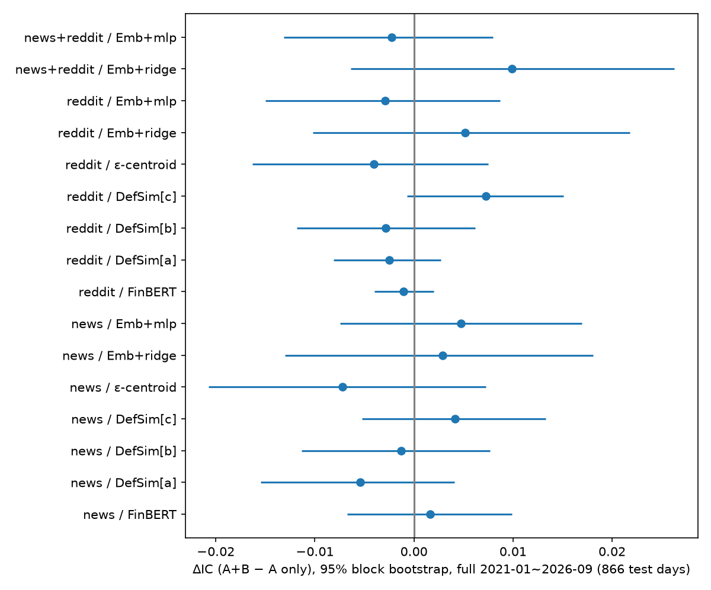

# 모델 B 실험 — 감성 점수 대신 문장 임베딩 표현 (2021-01 ~ 2026-09)

재현: Colab 노트북 `notebooks/modelB_embedding.ipynb` (`RANGE='full'`). 입력은 `news_full.parquet`(기사×종목, 제목+요약),
`reddit_full.parquet`(글×종목), `modelA_full.csv`이며 데이터는 레포에 없다(원문 포함·라이선스 문제).
이 문서는 집계 지표만 담고 있으며 Reddit·뉴스 원문은 없다. 원 지표는 `reports/model_b_embedding_results_full.csv`.

## 질문
FinBERT 감성 점수는 텍스트를 "긍정−부정" 숫자 하나로 압축한다. [model_b_experiment_2021.md](model_b_experiment_2021.md)에서 텍스트 효과가
확인되지 않았는데, 원인이 이 압축 방식일 수 있다. 같은 텍스트·같은 ε·같은 평가 틀에서 임베딩 기반 표현을 쓰면 모델 A 단독보다 나아지는가?

## 설정
- 데이터·타깃·평가 틀은 model_b_experiment_2021.md와 같다: 공통 구간 2021-01-04 ~ 2026-09-30, 10종목 × 1,442거래일 = 14,420행,
  타깃 `residual = real_ret − pred_ret`(모델 A=Chronos-2, H=3), walk-forward 5블록(첫 40% 학습 전용), 학습은 테스트 시작 3거래일 전까지(purge),
  테스트 866거래일, 날짜별 횡단면 Spearman IC, t값은 표본 수를 n/3으로 줄여 계산.
- 인코더: `sentence-transformers/all-MiniLM-L6-v2`(384차원, 최대 128토큰 — 128토큰 초과 비율 뉴스 12.9%, Reddit 6.5%). 뉴스·Reddit 공통.
  텍스트 단위: 뉴스는 기사×종목(제목+요약, 노이즈 제외 후 177,267건), Reddit은 글×종목(1,424,983건).
- 방법(모두 fold 안에서 학습 구간만 사용):
  - `FinBERT`: 기존 감성 점수의 종목·일 평균 × β(학습 구간 OLS, 원점 통과). 위 리포트의 다중 피처 모델과는 다른 단순 기준선이다.
  - `정의유사도[a/b/c]`: 호재/악재 정의문 임베딩과의 코사인 유사도 차를 기사별로 구해 일 평균, × β. 정의문 3종으로 표현 민감도 확인. 학습 없음.
  - `ε-centroid`: 학습 구간에서 ε>0 / ε<0인 날의 일평균 임베딩 평균과의 유사도 차, × β.
  - `임베딩+ridge / mlp`: 일평균 임베딩(표준화) → ε. 하이퍼파라미터는 학습 구간 마지막 20%(purge 3일)로 선택하고,
    같은 검증 구간에서 예측 크기를 보정(β≥0, 음수면 0).
  - 기사가 없는 칸은 ε̂=0.
- 최종 평가: r̂ = pred_ret + ε̂ 와 모델 A 단독(pred_ret)의 날짜별 IC 차(ΔIC). ΔIC의 95% 구간은 블록 길이 5일 순환 블록 부트스트랩(2,000회).

## 결과
| 소스 | 방법 | ε IC | t | 최종 IC | t | ΔIC (A 대비) | 95% 구간 | R²(상수 대비) |
|---|---|---|---|---|---|---|---|---|
| 뉴스 | FinBERT | 0.0119 | 0.55 | 0.0403 | 1.99 | 0.0017 | [-0.0067, 0.0099] | -0.0137 |
| 뉴스 | 정의유사도[a] | -0.0015 | -0.07 | 0.0332 | 1.65 | -0.0054 | [-0.0154, 0.0041] | -0.0139 |
| 뉴스 | 정의유사도[b] | 0.0029 | 0.14 | 0.0374 | 1.85 | -0.0013 | [-0.0113, 0.0077] | -0.0051 |
| 뉴스 | 정의유사도[c] | 0.0145 | 0.71 | 0.0428 | 2.10 | 0.0042 | [-0.0052, 0.0133] | -0.0035 |
| 뉴스 | ε-centroid | -0.0206 | -0.93 | 0.0315 | 1.51 | -0.0072 | [-0.0207, 0.0073] | -0.0204 |
| 뉴스 | 임베딩+ridge | 0.0226 | 1.08 | 0.0416 | 2.05 | 0.0029 | [-0.0130, 0.0181] | -0.0048 |
| 뉴스 | 임베딩+mlp | 0.0239 | 1.15 | 0.0434 | 2.11 | 0.0047 | [-0.0075, 0.0169] | -0.0127 |
| Reddit | FinBERT | -0.0154 | -0.77 | 0.0376 | 1.84 | -0.0010 | [-0.0040, 0.0020] | -0.0199 |
| Reddit | 정의유사도[a] | -0.0062 | -0.32 | 0.0362 | 1.80 | -0.0025 | [-0.0081, 0.0027] | -0.0203 |
| Reddit | 정의유사도[b] | -0.0099 | -0.52 | 0.0358 | 1.77 | -0.0028 | [-0.0118, 0.0062] | -0.0066 |
| Reddit | 정의유사도[c] | 0.0006 | 0.03 | 0.0459 | 2.26 | 0.0072 | [-0.0007, 0.0151] | -0.0076 |
| Reddit | ε-centroid | -0.0029 | -0.13 | 0.0346 | 1.68 | -0.0041 | [-0.0163, 0.0075] | -0.0216 |
| Reddit | 임베딩+ridge | 0.0035 | 0.15 | 0.0438 | 2.12 | 0.0052 | [-0.0102, 0.0218] | -0.0134 |
| Reddit | 임베딩+mlp | -0.0171 | -0.75 | 0.0357 | 1.76 | -0.0029 | [-0.0150, 0.0087] | -0.0153 |
| 뉴스+Reddit | 임베딩+ridge | 0.0219 | 0.92 | 0.0486 | 2.36 | 0.0099 | [-0.0064, 0.0263] | -0.0115 |
| 뉴스+Reddit | 임베딩+mlp | -0.0005 | -0.02 | 0.0364 | 1.79 | -0.0023 | [-0.0131, 0.0080] | -0.0200 |
| (모델 A 단독) | Chronos-2 | | | 0.0387 | 1.90 | | | |

## 해석
- **사전에 정한 기준(ΔIC의 95% 구간이 0을 제외)을 통과한 방법이 없다.** 16개 방법 모두 구간이 0을 포함하며 ΔIC 범위는 약 −0.007 ~ +0.010이다.
- 최고 점추정은 뉴스+Reddit 임베딩+ridge(ΔIC +0.0099, 구간 [−0.0064, +0.0263])이지만 구간이 넓고 0을 포함한다.
- ε IC는 모두 |t| < 1.2이고, `R²(상수 대비)`는 전부 음수다. 학습 구간 평균 ε만 쓰는 기준선보다 오차를 줄인 방법이 없다.
- FinBERT 단순 기준선 대비 임베딩 방법의 우위도 확인되지 않았다(구간이 모두 겹친다).
- 6개월(2026-05~09, 평가 약 63일) 탐색 실험에서는 `Reddit/정의유사도[c]`가 구간이 0을 살짝 벗어났고(ΔIC +0.048) 뉴스 ε-centroid의 점추정이 컸으나,
  전체 구간에서는 각각 0을 포함하는 쪽으로 돌아왔고(+0.0072) 부호가 반대(−0.0072)가 되었다. 표본이 작을 때의 잡음으로 판단한다.
- 정의유사도와 FinBERT의 기사 단위 Spearman 상관은 뉴스 0.49, Reddit 0.41로, 임베딩 점수가 감성을 대체로 따라간다는 점은 확인된다.
  (예측력과는 별개의 타당성 점검이다.)
- "FinBERT 점수의 1차원 압축이 병목"이라는 가설은 이 데이터·설정에서는 지지되지 않았다. 텍스트에 신호가 없다는 증명은 아니다.

## 한계
- 시도한 방법이 16개로 많아 구간이 0을 살짝 벗어나는 정도는 우연일 수 있다(이번에는 해당 사례 없음).
- ΔIC 구간 폭이 ±0.01~0.02라서 그보다 작은 효과는 이 표본으로 구별할 수 없다. 모델 A 자체의 IC가 0.0387로 낮아 B가 보탤 여지도 작다.
- 인코더는 MiniLM 하나다. SocBERT(Reddit용) 등 다른 인코더는 비교하지 않았다. 정의문은 3종뿐이다.
- 일 단위 평균 임베딩으로 집계해 기사 간 정보가 희석된다. 128토큰 초과 텍스트는 잘린다.
- 평가 설정은 한 가지(5블록, purge 3일)이고 시드는 1개다. 노트북의 MLP·부트스트랩 시드는 고정되어 있으나 반복 실험은 하지 않았다.
- 수익률 방향이 아닌 변동성·거래량 같은 다른 타깃은 확인하지 않았다.
